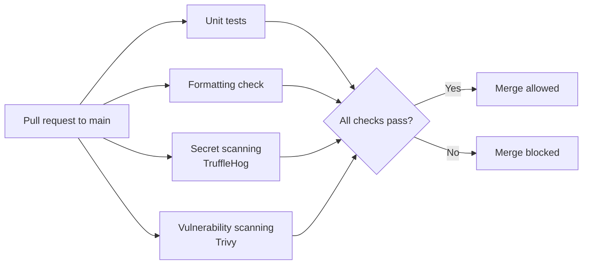

# Secure CI/CD Pipeline

A Go web application used as a hands-on project for building a **DevSecOps pipeline with GitHub Actions**, embedding security checks directly into the CI/CD process so issues are caught before code reaches `main`.

> **Status:** In progress. See the [roadmap](#roadmap) for what's complete and what's next.

## Why this project

CI/CD systems have become a prime target for attackers because they hold source code, secrets, and the path to production. This project applies the [OWASP Top 10 CI/CD Security Risks](https://owasp.org/www-project-top-10-ci-cd-security-risks/) to a real pipeline, one control at a time.

## Pipeline overview



## Roadmap

### CI foundation
- [x] Unit tests with coverage reporting on every pull request
- [x] Formatting check (`go fmt`) as a separate parallel job
- [x] Go version read from `go.mod` (single source of truth, no outdated toolchain)

### Security controls
- [x] Secret scanning with TruffleHog
- [ ] Dependency and Dockerfile vulnerability scanning with Trivy
- [ ] All third-party actions pinned to full commit SHAs (supply chain protection)
- [ ] Least-privilege `permissions:` on workflows
- [ ] Branch protection: required status checks before merging to `main`

## Verifying the controls

Security controls are only trusted once they're tested.

### Secret scanning (tested October 2026)
- Created a [canary token](https://canarytokens.org): a decoy AWS key with no permissions that alerts its owner when used.
- **Layer 1, GitHub push protection:** blocked the push and identified an Amazon AWS Secret Access Key.
- **Layer 2, TruffleHog in CI:** after a deliberate, documented bypass ("used in tests"), the Secret Scan job reported a **verified** AWS credential and failed the pull request with exit code 183 ([test PR #5](https://github.com/TifLSmith/secure-cicd-pipeline/pull/5), closed without merging).
- **Cleanup:** PR closed, branch deleted, canary token disabled.
- **Finding:** the scan pulled `trufflehog:latest`, an unpinned image. Pinning is tracked in the roadmap.

### Stretch goals
- [ ] Kubernetes deployment manifest for the app
- [ ] Kubernetes misconfiguration scanning (Trivy or Kubescape)
- [ ] Signed build provenance (SLSA)

## Tech stack

- **Language:** Go
- **CI/CD:** GitHub Actions
- **Security tooling:** TruffleHog, Trivy
- **Containerization:** Docker

## Running locally

Create a `.env` file in the project root:

```
PORT="8080"
```

Build and run:

```bash
go build -o notely && ./notely
```

The server starts at `http://localhost:8080` in non-database mode.

## Credits

The base "Notely" application comes from the [Learn CI/CD course on Boot.dev](https://boot.dev). The pipeline design and security hardening in this repository are my own work.
